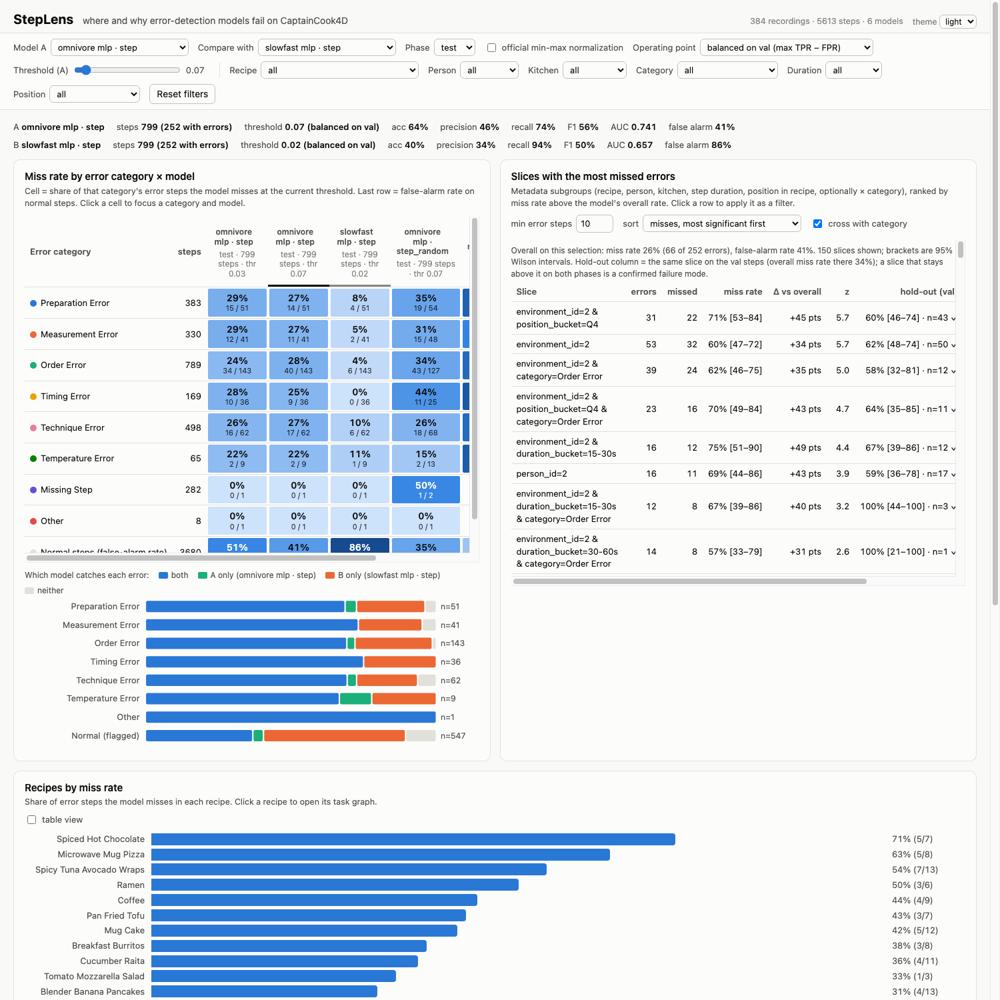

# StepLens

Visual analytics for diagnosing step-level error-detection models on
[CaptainCook4D](https://github.com/CaptainCook4D) (DS-GA 3001, NYU, Fall 2026).

StepLens reproduces the paper's supervised error-recognition baselines over the
released frozen features, stores every model's per-step and per-second scores,
and links four views: an error-category × model miss-rate matrix, recipe task
graphs colored by miss rate, recording timelines with video, and a slice table
that ranks metadata subgroups by how much worse the model does there.



Screenshots: [overview](docs/screenshots/overview-light.png) (matrix, compare strip, slices,
recipes), [kitchen 2 drill-down](docs/screenshots/kitchen2-drilldown.png),
[task graph in dark mode](docs/screenshots/taskgraph-dark.png).

## Layout

```
steplens/          python package
  data.py          annotations -> data/processed/{recordings,steps,segments}.parquet + task_graphs.json
  features.py      per-recording feature loader (official file layout)
  models.py        MLP and transformer heads ported from error_recognition
  train.py         training/eval, writes data/predictions/<model_id>/
  metrics.py       step metrics, per-category recall, slice discovery
  server.py        FastAPI backend + static front end
frontend/          index.html, styles.css, app.js, views.js (D3 v7 from cdnjs, no build step)
scripts/           download_features.sh, download_videos.sh
vendor/            official repos (annotations, error_recognition, feature_extractors, downloader)
data/              features/, processed/, predictions/, videos/ (all generated or downloaded, not committed)
```

## Quick start (no training needed)

The repository contains the processed tables (`data/processed`); the models' predictions
are published as a release asset. You only need Python 3.10+:

```bash
git clone <this repo> && cd Visulization_Of_ML
# download StepLens_predictions.zip from the Releases page and unzip it in this folder,
# which creates data/predictions/<model_id>/{meta.json,steps.parquet,seconds.parquet}
unzip ~/Downloads/StepLens_predictions.zip
python3 -m venv .venv && .venv/bin/pip install -r requirements.txt
.venv/bin/uvicorn steplens.server:app --port 8781
open http://127.0.0.1:8781/
```

If you received the project as a full zip instead, `data/predictions` is already there;
skip the unzip line.

Features (3.7 GB) and videos are not in the bundle; they are only needed to retrain or
to play clips, and `scripts/download_features.sh` / `scripts/download_videos.sh` fetch
them from the public Box archive.

## Setup

```bash
# python 3.10 with torch, pandas, scikit-learn, then:
python -m venv --system-site-packages .venv   # or a fresh venv + pip install -r requirements.txt
.venv/bin/pip install fastapi "uvicorn[standard]" h5py pyarrow tqdm

git clone --depth 1 https://github.com/CaptainCook4D/annotations vendor/annotations
git clone --depth 1 https://github.com/CaptainCook4D/error_recognition vendor/error_recognition
git clone --depth 1 https://github.com/CaptainCook4D/downloader vendor/downloader

scripts/download_features.sh          # ~3.7 GB: omnivore, slowfast (1 s) + imagebind video/audio/text (2 s)
cd data/features && for z in gopro_1s/*.zip; do unzip -q -o "$z" -d gopro_1s; done \
  && for z in gopro_2s/*.zip; do unzip -q -o "$z" -d gopro_2s; done && cd ../..

.venv/bin/python steplens/data.py     # build the processed tables
```

## Train a model

```bash
.venv/bin/python -m steplens.train --backbone omnivore --variant mlp --split step --epochs 30 --device cpu
.venv/bin/python -m steplens.train --backbone omnivore --variant transformer --split step --epochs 40 --device mps
.venv/bin/python -m steplens.train --backbone imagebind --variant transformer --modality video audio text --split step
```

Splits: `step` (the official per-recording step split, which is *not* shuffled:
train = first 75% of each recording's steps, "test" = next 16%, "val" = last 9%),
`step_random` (same proportions, seeded shuffle), `recordings`, `person`,
`environment` (the official recording-level splits). Learning rates default to
the official values (1e-3 MLP, 1e-6 transformer).

Each run writes `data/predictions/<model_id>/{meta.json,steps.parquet,seconds.parquet,best.pt,train.log}`.
Extra options: `--lr`, `--tag` (suffix for the model id), `--center recording`
(subtract each recording's mean feature), `--upweight technique temperature --upweight_factor 2`
(loss weight for error steps of those categories).

## Findings-guided fixes and reports

```bash
.venv/bin/python -m steplens.calibrate --model omnivore_mlp_video_step_lr1e-4 --by environment_id
    # per-kitchen thresholds tuned on val, evaluated on test; writes <model>_cal-environment/ as a derived model
.venv/bin/python scripts/results_table.py      # docs/results.md: every model vs the paper's numbers
.venv/bin/python -m unittest discover -s tests # metric and slice-discovery tests
```

Documents: `proposal/Team17.pdf` (the submitted proposal), `docs/findings.md` (findings log), `docs/case_studies.md` (walkthroughs with
video), `docs/results.md` (all models), `docs/seeds.md` (seed robustness), `docs/report.md`
(report draft), `docs/slides_outline.md`, `docs/user_study/` (protocol, task sheet, SUS,
consent, reference findings, baseline notebook + CSVs; designed, not run).

License note: the dataset is released under Apache 2.0 (website, downloader and
error_recognition repos; the annotations README says the same, its LICENSE file is MIT).

## Run the tool

```bash
.venv/bin/uvicorn steplens.server:app --port 8781     # or scripts/serve.sh
open http://127.0.0.1:8781/
```

The page keeps its state in the URL (model A/B, phase, operating point, filters,
recording, theme), so a view can be shared as a link. Operating points: each
model's threshold is chosen on its own validation steps (balanced = max TPR −
FPR, or best F1), or the paper protocol (min-max normalized scores at 0.6 / 0.4),
or one custom threshold for all models.

Optional videos for the timeline view: `scripts/download_videos.sh 16_27 25_48`
(360p GoPro, ~100 MB per 10-minute recording).

## Notes on the data

* Missing Step errors sit on steps with start/end = -1; they have no features and
  no model ever scores them. The matrix shows them as "–".
* The annotation files include an eighth category, Other (8 errors).
* ImageBind features exist for 383 of 384 recordings (12_6 is absent); no depth
  features are in the public archive.
