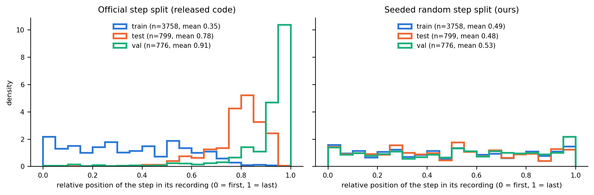
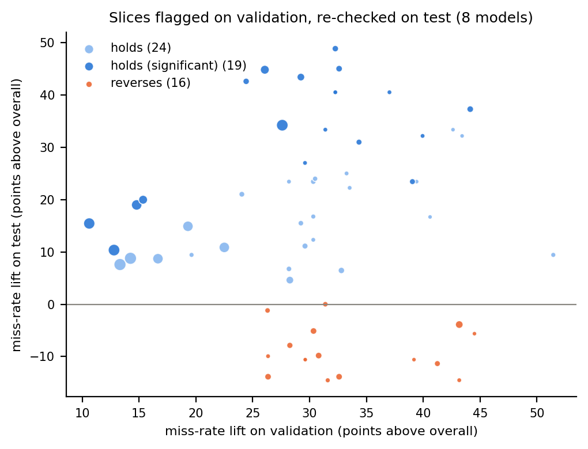

# StepLens: Visual Analytics for Diagnosing Error-Detection Models in Procedural Cooking Videos

*DS-GA 3001, Fall 2026 · Team 17: Harvey Yang, Jeremy Hsu · draft of Oct 26, 2026 (revised after the proposal feedback)*

## Abstract

CaptainCook4D (Peddi et al., NeurIPS 2024) labels every recipe step in 384 egocentric
cooking recordings as normal or as one of seven kinds of mistake, and benchmarks
supervised error-recognition models with a single accuracy, F1 and AUC per model. We
built StepLens, an interactive system that links an error-category × model miss-rate
matrix, recipe task graphs colored by miss rate, recording timelines aligned with the
video, and a slice table that ranks metadata subgroups by how much worse a model does
there, with hold-out confirmation. The authors' released checkpoints, scored on our
reconstruction of the test phase, reproduce the paper's step-split numbers to within 0.6
points; our own retrained models reach 74.3 ± 2.2 AUC (MLP) and 73.3 (transformer) against
75.7. Failures are not mainly category-specific: per-category recall varies by a few
points for our Omnivore models. They are cook- and recording-specific: one participant is
missed more often than average by every model we checked, including the authors' four
checkpoints, and on held-out recordings steps with a single subtle error are missed more
often than steps with compound errors. Re-implementing the benchmark also surfaced two
properties of the released code that affect how its numbers are read: steps annotated as
skipped are not evaluated, so the Missing Step category is outside the benchmark, and the
step split assigns steps to phases in annotation order, so its validation and test phases
differ in position within the recipe. Two findings-guided fixes did not improve F1, and we
explain why. We evaluate the tool
through four case studies, each of which produced a finding that the paper's tables
cannot show and that survives the tool's hold-out, model-switch and seed checks.

## 1. Introduction

Models that watch a person follow a procedure and flag mistakes are evaluated, almost
without exception, with aggregate metrics. CaptainCook4D is the first large egocentric
dataset with deliberately induced, step-level, categorized errors, and its benchmark
reports accuracy, F1 and AUC per backbone and head. Those numbers do not say which of the
seven error categories a model catches, whether it fails on particular recipes or steps,
or whether two backbones fail on the same steps. We asked three questions:

* **RQ1.** Where do the supervised error-recognition models fail: which categories,
  recipes, steps, cooks, kitchens, step lengths and positions account for the misses and
  the false alarms, and are the failures systematic?
* **RQ2.** Do Omnivore, SlowFast and multimodal ImageBind models miss the same errors?

Our contributions are the open-source tool, a failure analysis of the paper's baselines
broken down by category and slice, an evaluation of two fixes suggested by that analysis,
and a case-study evaluation of the tool. Sections 3 and 5 also document several
properties of the released benchmark that affect how its numbers should be read.

## 2. Related work

Assembly101, HoloAssist and PREGO study mistakes in procedural tasks; HD-EPIC annotates
real kitchens in detail; Ego4D and Ego-Exo4D provide keystep annotations at scale. They
evaluate models with aggregate metrics, and to our knowledge none of them ships a tool for
inspecting the failures of the models benchmarked on it. The closest system we know of is
ARGUS (Castelo et al., IEEE VIS 2023), which visualizes the outputs of perception and
step-detection models next to the sensor streams of AR task-guidance sessions, live and
after the fact; StepLens differs in aggregating across hundreds of recordings by error
category and metadata slice and in checking whether a slice is stable. On the visual-analytics side, ModelTracker and Squares show per-instance and
per-class performance, Manifold compares models where they disagree, the What-If Tool
probes slices, Calibrate analyzes probabilistic outputs and Domino discovers
underperforming slices automatically. StepLens borrows per-class matrices, model
comparison and slice discovery from this line of work and adds what procedural video
needs: steps aligned in time, task graphs, linked playback, and a hold-out check on every
slice. (Full references in the proposal.)

## 3. Data, and what re-implementing the benchmark revealed

We use the public annotations (step and error labels, task graphs, splits), the released
frozen features (Omnivore, SlowFast, X3D, 3D-ResNet at 1 s; ImageBind video, audio and
text at 2 s) and the 360p GoPro videos of ten recordings. The dataset is released under
Apache 2.0 (project website, downloader and error-recognition repositories; the
annotations repository's README says the same while its LICENSE file is MIT). The feature archive is public
and 114 GB; the 9 GB of segment features are all that the benchmark needs. The authors
also released the checkpoints used in the paper (error_recognition issue #1); we score
every step with eight of them (section 5). Code references below are to
`error_recognition` at commit `35ef284`; full evidence is in `docs/feedback_response.md`.

1. **Skipped steps are not evaluated.** Steps annotated as skipped have no video segment
   (start and end time −1) and the released dataloader excludes them
   (`CaptainCookStepDataset.py` L89–90), so the supervised benchmark does not evaluate
   the Missing Step category (285 of 2,566 annotated errors). StepLens shows that row as
   "–" in every model column.
2. **The step split follows annotation order.** In the released code the shuffle acts on
   a temporary copy of the step list (L146–147), and steps are then assigned in
   annotation order (L152–189): the first 75% of each recording's steps to train, the next
   16% to the phase named "test", the last 9% to "val". The phases therefore differ in
   position within the recipe (mean relative position 0.35, 0.78, 0.91; Fig. 1), and
   validation results transfer poorly to test: the authors' own Omnivore MLP checkpoint
   has validation AUC 65.6 and test AUC 76.2. That the authors' checkpoints reproduce
   Table 10 on exactly this test phase (section 5) confirms that this is the split the
   paper evaluated on. We add a seeded random split with the same proportions as a
   control.
3. **Steps carry several errors.** 518 of the 1,659 scored error steps carry two or more
   of the six scored categories; the files also contain an eighth category, Other (8
   errors), which we show separately.
4. **The public archive has no depth features**, so the paper's four-modality ImageBind
   model cannot be reproduced; ImageBind features cover 383 of 384 recordings.
5. **Smaller observations.** The thresholds that reproduce Table 10 (min-max
   normalization of the test scores, 0.6 for the step split and 0.4 otherwise) are given
   in the README, while the evaluation script sweeps 0.5 and 0.6. In Table 8 one F1 value
   (TimeChat, Missing Steps) differs from the value its precision and recall imply (12.4
   vs 2 × 2.2 × 0.4 / 2.6 = 0.68). The evaluation script defines `val_best_epochs` and
   `test_best_epochs`; for the recording, person and environment splits the epochs used,
   and the released checkpoints, match `test_best_epochs` in 36 of 42 configurations.
   Re-scoring the alternative epochs moves test F1 in both directions, so we report this
   only as an observation.

## 4. StepLens

**Prediction store.** Every trained model writes a per-step score (mean of the per-second
sigmoid outputs, as in the official evaluation) and the per-second scores themselves,
with the phase each step belongs to. The tool reads these files and the processed
annotation tables; adding a model is dropping a folder.

**Views.** (1) The *matrix* has one row per error category plus a row for normal steps,
one column per model; a cell is the share of that category's error steps the model
misses (or, in the last row, the false-alarm rate) with its counts, on a single-hue
sequential scale. (2) The *task-graph view* lists recipes by miss rate and, for one
recipe, draws its DAG of step-order constraints with each step colored by miss rate.
(3) The *timeline* shows one recording's ground-truth steps colored by category, the
outcome of each test step (caught, missed, false alarm), the per-second score curves of
up to two models with their thresholds, and the video, which seeks to a step on click.
(4) The *slice table* enumerates single and pairwise conjunctions of recipe, person,
kitchen, step-duration bucket and recipe-position bucket, optionally crossed with a
category, and reports for each the miss rate with a 95% Wilson interval, the gap to the
overall rate, a binomial z-statistic (the default ranking, which discounts tiny slices),
the AUC inside the slice, and the same slice re-evaluated on the hold-out phase. A
*compare strip* shows, per category, how many errors both models catch, only one
catches, or neither.

**Steps with several categories.** The model makes one error/normal decision per step.
In the matrix a step counts in every category row it carries and is caught or missed in
all of them at once, so rows overlap (the 252 test error steps contribute 342 category
entries). A switch restricts the matrix to single-category steps; for the transformer this
changes per-category recall by at most 6 points, so no category claim depends on the
convention. Co-occurrence is strongest for Temperature: 75% of its steps carry another
category, and only two test steps are Temperature-only.

**Operating points.** Raw score scales differ by model (the balanced threshold is 0.01
for one transformer and 0.07 for an MLP), so one global threshold would be unfair. Each
model's threshold is chosen on its own validation steps, by a rule the user picks:
balanced (maximize TPR − FPR, the default), best F1, the paper's protocol (min-max
normalize the step scores, threshold 0.6 on step splits and 0.4 otherwise), or one
custom threshold for all.

**Linking.** Every click is a filter (a matrix cell sets category and model, a slice row
sets its attributes, a task-graph node sets the step, a recipe bar opens its graph), and
all views re-render against the same selection. The complete state lives in the URL, so a
finding is a link. Light and dark themes use the same validated palette.

**Implementation.** Python (pandas, PyTorch, FastAPI) and D3 without a build step; 40
prediction sets at the time of writing (32 trained by us, 8 from the authors' checkpoints); headless-browser click tests cover every linked
interaction.

## 5. Reproducing the baselines

**The authors' checkpoints.** Their parameter names match our port of the heads, so we
load them unchanged and score every step. On the step split's test phase they reproduce
Table 10 under the README protocol: the transformer gets accuracy 69.96 (paper 69.96),
precision 52.1 (51.6), recall 59.5 (59.8), F1 55.6 (55.4) and AUC 75.8 (75.7); the MLP gets
70.8 (71.1), 67.3 (66.1), 14.7 (14.9), 24.1 (24.3) and 76.2 (75.7). This validates our data
pipeline and test-phase reconstruction, and it shows that the two models' AUCs are
genuinely close rather than copied.

**Our own training.** We ported the released training loop (one step per batch, BCE on
every 1-second row without a positive-class weight, Adam, gradient clipping, model
selection by validation AUC). These settings come from the code; the paper states batch
512, a positive-class weight of 1.5 and 50 epochs, and the first author confirmed in issue
#3 that the paper's settings were used, which explains part of the gap below.

| Model, official step split, test phase | AUC (ours / paper) | Paper protocol F1 (ours / paper) | Balanced point: recall / false alarm / F1 |
| --- | --- | --- | --- |
| Omnivore MLP, official lr 1e-3 | 68.0 / 75.7 | 3.9 / 24.3 | 75.0 / 50.8 / 52.6 |
| Omnivore MLP, lr 1e-4 | 74.1 / 75.7 | 3.9 / 24.3 | 73.8 / 40.6 / 56.4 |
| Omnivore transformer, official lr 1e-6 | 71.8 / 75.7 | 11.2 / 55.4 | 76.6 / 44.2 / 56.2 |
| Omnivore transformer, lr 1e-5 | 73.3 / 75.7 | 30.7 / 55.4 | 87.7 / 55.9 / 56.7 |
| SlowFast MLP, lr 1e-4 | 68.3 / – | 19.2 / – | 61.5 / 35.1 / 51.8 |
| ImageBind V+A+T transformer, official | 60.5 / – | 14.1 / – | 53.6 / 40.8 / 44.3 |
| Omnivore MLP, lr 1e-4, random step split | 80.1 / – | 3.1 / – | 65.5 / 20.1 / 62.6 |

Three observations. First, with a ten-times smaller learning rate our Omnivore models
land within 2.4 AUC points of the paper (and within seed noise: 74.3 ± 2.2 over three
seeds); at the code's learning rate the MLP's training loss never drops below the
constant predictor's. Second, the README protocol reproduces the paper with the authors'
checkpoints but flags almost nothing with ours: min-max normalization over the test
scores makes the 0.6 threshold depend on each model's score distribution, which differs
with the training settings. At a balanced operating point chosen on validation, every
Omnivore model, ours or the authors', MLP or transformer, lands at F1 56–57. Third, the split matters more than the head: the same MLP recipe
scores 74.1 on the official step split and 80.1 on the random one, partly because
selection on the official "val" phase (last steps of each recipe) is unreliable for its
"test" phase (middle steps).

The three-modality ImageBind models fail at every learning rate we tried. The released
embeddings are on different scales (video rows are unit vectors, audio rows have norm
about 20, text rows about 80) and the official code concatenates them as is; but
normalizing them does not rescue the model (61.5 AUC), and single-modality heads show
why: audio alone reaches 59.2 and text 56.2. Without the depth stream, the multimodal
features are weak for this task. Full table: `docs/results.md`.

## 6. Findings

**RQ1a: not by category.** At its balanced point the tuned Omnivore MLP misses 22–28% of
every category (Preparation 27, Measurement 27, Order 28, Timing 25, Technique 27,
Temperature 22); the transformer misses 0–16%. Supervised models catch the Timing and
Temperature errors that the paper's zero-shot models almost never detect, at the price of
35–56% false alarms. SlowFast is the only backbone with a category profile: it misses
Preparation and Technique errors most (45%, 44%) and Temperature least (11%).

**RQ1b: by cook.** Person 2 is missed more often than average by every model we checked,
on every split and seed: 65 ± 6% by our Omnivore MLP (three seeds, 25% overall), 38 ± 5%
by our transformer (17 ± 4% overall), 61% by the recording-split transformer on five
held-out recordings (26% overall), and 62%, 100%, 89% and 22% by the authors' four
Omnivore checkpoints under the paper's protocol (overall 40%, 85%, 63% and 14%).
Per-person AUC is lower than overall for most of these models (e.g. 0.56–0.61 vs
0.68–0.74 for ours), though not for every one. The walkthroughs (case study 1) show misses that are quantity
and duration deviations, caught errors that involve a visible event.

**RQ1c: by kitchen, with a caveat.** For the tuned MLP on the official step split, kitchen
2 is missed 60% of the time (26% overall), confirmed on the hold-out phase, with slice AUC
0.65. Re-training the same recipe with two more seeds gives 23% and about 40% (41 ± 15%),
while person 2 stays at 65 ± 6%. Kitchen 2 is modestly above average on most step-split
models (our transformer +7 to +11 points on each seed, the authors' transformer +15) and at
the average on held-out recordings, so the finding is "kitchen 2 is somewhat harder, and
the size of the effect is not stable", not the 34-point gap one run suggested. The tool's
hold-out column catches sampling noise but not run-to-run variance, so we report seeds
separately (`docs/seeds.md`).

**How often a flagged slice survives.** Across eight models, 71 slices were flagged on
validation (z ≥ 2, at least 10 error steps); of the 59 with at least 5 test errors, 43
(73%) stay above the overall miss rate on test, 19 (32%) stay significant, and 16 (27%)
reverse (Fig. 2, `docs/slice_survival.md`). Across seeds of the same configuration only
4–7 of 8–11 flagged slices are flagged again. On the official step split survival is
100%, which is not reassuring: its validation and test steps come from the same
recordings, so a person or kitchen effect carries over by construction. A single flagged
slice is therefore a hypothesis; we call it a finding only after the model and seed checks.

**RQ1d: position and compound errors.** On the random split the first and last quarters
of a recipe are missed most (40%, 42% vs 25–31%); the official split cannot show this
because it has 27 early test steps. On held-out recordings, steps with a single error are
missed 30% of the time and steps with two or more errors 18% (Measurement-only 27% vs 5%,
Timing-only 50% vs 18%). Step duration and quantity wording have no consistent effect.

**RQ2: do backbones miss the same errors?** Omnivore MLP vs SlowFast MLP on 252 test
error steps: both catch 124, Omnivore alone 62, SlowFast alone 31, neither 35. A union
would reach 86% recall but also 54% false alarms (both flag 116 normal steps, Omnivore
alone 106, SlowFast alone 76). The complementarity is at the operating point, not in
category-specific skills, and Omnivore features dominate on every head and split.

## 7. Fixes guided by the findings

| Fix | Motivation | Result on test | Why |
| --- | --- | --- | --- |
| Per-kitchen thresholds tuned on validation | kitchen 2 slice | kitchen 2 misses 60% → 4%, its false alarms 23% → 87%; overall F1 56.4 → 55.8 | a threshold moves the operating point inside a slice, it cannot add separation (slice AUC 0.65) |
| Per-recipe thresholds | recipe slices | F1 56.4 → 54.2 | overfits small per-recipe validation sets |
| Per-recording feature centering | kitchen/session shift | AUC 74.1 → 70.4; kitchen 2 AUC 0.65 → 0.63 | the recording mean carries signal the head uses |
| Category upweighting | — | not run | the findings do not point at categories |

The negative results are themselves informative: the models' remaining errors are
single, subtle deviations of quantity, duration and order on recordings of particular
cooks, which per-step appearance features at 360p cannot represent. The fixes that the
findings point to are temporal context across steps (order errors are relative to other
steps) and the depth stream for the multimodal model.

## 8. Evaluating the tool: case studies

We evaluate StepLens with case studies that ask whether the tool surfaces findings the
existing workflow cannot, and whether its safeguards tell a real finding from a spurious
one. Because case studies written by the tool's authors can be chosen to fit the tool, we
compare against a strong baseline, not only against the paper's tables: a notebook with
slicing tables (every attribute and pair, with hold-out columns) and plots of the miss
rate per attribute with Wilson intervals, a person × kitchen heat map and score
histograms (`docs/user_study/baseline_notebook.ipynb`). Full walkthroughs with video
links are in `docs/case_studies.md`.

| Case study | View that surfaced it | What the aggregate tables could not show | Safeguard outcome |
| --- | --- | --- | --- |
| 1. A held-out cook (person 2, recordings 25_40 and 27_37) | slice table → timeline + video | one participant is missed 61–69% by every model; the misses are quantity and duration deviations, the catches visible events | holds on hold-out, across splits, across seeds |
| 2. Temperature and Timing errors | matrix | supervised models catch them as well as any category; Missing Step is never scored by anyone | holds for every model |
| 3. Kitchen 2 | slice table (z, hold-out, slice AUC) → compare mode | a 60%-missed slice with a confirmed hold-out whose size turned out to be a property of one run | the 34-point gap fails the seed check; a smaller +7 to +15 point effect remains on most step-split models |
| 4. Position in the recipe | slice table on two splits | the official split has one early test step; the random split shows first/last quarters missed most | holds on the random split only |

Which findings each workflow surfaces:

| Finding | Notebook (slicing + plots) | StepLens |
| --- | --- | --- |
| Categories are missed at similar rates | yes (bar chart) | yes (matrix) |
| Person 2 is missed far more than average | yes (bar chart with CI) | yes (top of the slice table) |
| Kitchen 2 at 60% for one run | yes, and it looks just as convincing | yes, with hold-out and slice AUC |
| Kitchen 2's size is unstable across seeds and models | only by re-running per model and seed | one-click model switch; seeds offline |
| Kitchen 1 raises the most false alarms | yes (tables) | yes (sort by false alarms) |
| Pairwise slices and their validation-to-test survival | tables yes; survival needs extra code | built into every row |
| Why misses happen (quantity and duration deviations are invisible) | no | timeline + video |
| Single-category errors missed more than compound ones | no | not directly; hypothesis from clips, number from code |
| Missing Step is never scored | only if the absent rows are noticed | "–" row in the matrix |
| The step split's position bias | no | no; found by reading the code |

A careful notebook finds most single-attribute rate findings. What the tool adds is
validation attached to every slice with fast switching between models, which is what
exposed the instability of kitchen 2, and the link from a number to the video, which is
where the explanations came from. Neither view found the properties of the benchmark
code; reading the code did. A controlled user study would need IRB approval and is out of
scope. Materials for a future controlled study are in `docs/user_study/`.

## 9. Limitations

Three seeds for the three key MLP recipes and the tuned transformer, one seed for the
rest; across seeds the official-split Omnivore MLP varies by ±2.2 AUC, as large as its gap
to the paper (`docs/seeds.md`); our training follows the released code rather than the
paper's stated settings; one flagged slice in four reverses on new data; 360p
features released by the authors rather than our own; no depth features; Temperature has
nine test errors; the official step split's biases limit what can be said about
position; the tool is evaluated by case studies rather than a controlled user study; all
numbers come from one dataset and one domain.

## 10. Conclusion

The paper's aggregate numbers do not show that one category is outside the benchmark,
that the step split's phases differ in position within the recipe, or that one cook is
hard for every model, including the authors' own. A tool that keeps steps, slices and
video linked, insists on hold-out confirmation, and lets the analyst switch models found
all of them in a day, and also showed which of its own findings not to trust. The next
things to do are a controlled user study, multi-seed confidence intervals for every
model, and models with cross-step context.

## Appendix

* Reproduction commands: `README.md`. All results: `docs/results.md`. Findings log:
  `docs/findings.md`. Case studies with video: `docs/case_studies.md`.
* AI-use disclosure: Claude (Anthropic) was used to draft the proposal, implement the
  system and analysis code, run the experiments, and draft this report under our
  direction; all numbers were produced by the code in the repository.
